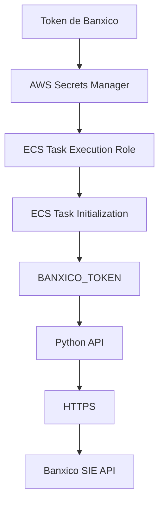

# Análisis y decisiones de seguridad

## Despliegue seguro de una API que consume datos del Banco de México (SIE)

Este documento presenta mi análisis realizado y las decisiones técnicas tomadas durante el desarrollo y despliegue de una API que consume información del Sistema de Información Económica (SIE) del Banco de México.

El objetivo no es únicamente describir los servicios utilizados, sino explicar los riesgos identificados, las alternativas consideradas y los controles seleccionados para reducir la superficie de exposición de la aplicación y su infraestructura.

## 1. Contexto y problema

La solución requiere desplegar en AWS una API que consuma información del Banco de México mediante su API SIE.

Para realizar las consultas es necesario contar con un token de autenticación, por lo que desde el inicio se identificó la necesidad de proteger esta credencial durante todo su ciclo de vida: almacenamiento, recuperación y utilización.

El problema no se limita a evitar que el token aparezca en el código fuente. También debemos garantizar que los servicios autorizados puedan recuperarlo sin proporcionar permisos innecesarios y que su utilización no provoque una exposición accidental en los logs o en la imagen del contenedor.

Por este motivo, el análisis se enfocó en los siguientes aspectos:

- Infraestructura como Código (IaC).
- Gestión y protección de secretos.
- Segmentación de red y control de acceso.
- Contenerización segura.
- Manejo de errores y protección de información sensible.
- Registro, monitoreo y diagnóstico.
- Automatización de controles de seguridad durante el desarrollo.

## 2. Gestión de secretos

### Problema identificado

La API necesita un token para autenticarse ante Banxico. Si esta credencial se almacena directamente en el código, el repositorio, una imagen Docker o un archivo de configuración compartido, existe el riesgo de que personas o servicios no autorizados puedan obtenerla.

Una filtración podría permitir el uso indebido de las credenciales y comprometer la disponibilidad o el consumo autorizado del servicio externo.

### Decisión: AWS Secrets Manager

Se seleccionó AWS Secrets Manager para almacenar el token de Banxico.

La decisión se tomó considerando que necesitamos separar las credenciales de la aplicación y permitir que un servicio autorizado las recupere durante su ejecución.

Sin embargo, el almacenamiento seguro por sí solo no resuelve el problema. También es necesario establecer qué identidad puede recuperar el secreto y cómo se entrega a la aplicación.

### Implementación

Se creó el recurso de Secrets Manager mediante Terraform, mientras que el valor del token se configuró directamente en AWS, evitando incorporarlo a los archivos de infraestructura.

Para permitir su recuperación se configuró un IAM Execution Role para ECS con una política específica de acceso al secreto.

Durante la inicialización de la tarea, ECS recupera el valor mediante la referencia `valueFrom` de la definición de tarea y lo proporciona al contenedor mediante la variable `BANXICO_TOKEN`.

El flujo implementado es:

### Controles considerados

- El token no se incorpora al código fuente.
- El valor no se declara directamente en los archivos Terraform.
- El secreto no se incluye durante la construcción de la imagen Docker.
- El acceso se limita mediante una política IAM asociada al Execution Role.
- La aplicación utiliza la credencial para realizar solicitudes autenticadas a Banxico.

### Consideración de seguridad

La inyección de secretos mediante variables de entorno evita tener que incluir la credencial en la imagen o administrarla manualmente dentro del contenedor. Sin embargo, el valor continúa estando disponible para el proceso de la aplicación durante su ejecución.

Por ello, es importante restringir el acceso a la tarea y evitar que los mecanismos de diagnóstico o registro expongan sus variables de entorno.

## 3. Manejo de errores y protección de información en logs

### Problema identificado

Durante el consumo de una API externa pueden ocurrir errores relacionados con la solicitud, autenticación, disponibilidad del proveedor, límites de consumo o conectividad.

Considero importante registrar el tipo de error que ocurre, ya que permite identificar qué está sucediendo y determinar si el problema corresponde a nuestra aplicación o al proveedor externo.

El objetivo es contar con información suficiente para diagnosticar el problema y determinar qué acciones deben tomarse, sin exponer información que pueda comprometer la seguridad.

### Información que no debe registrarse

Se identificaron los siguientes datos como información que debe excluirse de los logs:

- API Keys.
- Tokens de autenticación.
- Credenciales utilizadas para autenticar solicitudes.
- Headers de autorización.
- Información sensible incluida en las peticiones.
- Datos que permitan exponer mecanismos de autenticación o accesos al servicio.

### Clasificación de errores HTTP

La clasificación inicial considerada para el consumo de servicios externos es la siguiente:

| Código | Clasificación         | Descripción |
|--------|-----------------------|-------------------------------------------------------------------------------|
| 400    | Bad Request           | La solicitud contiene parámetros incorrectos o está mal estructurada.         |
| 401    | Unauthorized          | Las credenciales son inválidas, faltantes o han expirado.                     |
| 403    | Forbidden             | El cliente no tiene permisos para acceder al recurso.                         |
| 404    | Not Found             | El endpoint o recurso solicitado no existe.                                   |
| 408    | Request Timeout       | La solicitud excedió el tiempo permitido.                                     |
| 422    | Unprocessable Entity  | Los datos enviados no cumplen con las reglas de validación.                   |
| 429    | Too Many Requests     | Se excedió el límite de solicitudes permitido.                                |
| 500    | Internal Server Error | Ocurrió un error interno durante el procesamiento.                            |
| 502    | Bad Gateway           | Un servidor intermediario recibió una respuesta inválida del servicio externo.|
| 503    | Service Unavailable   | El servicio se encuentra temporalmente indisponible.                          |
| 504    | Gateway Timeout       | El servidor intermediario no recibió respuesta dentro del tiempo esperado.    |

También deben contemplarse errores de conectividad, resolución DNS, conexión y procesamiento que pueden ocurrir sin recibir una respuesta HTTP.

### Consideraciones sobre los límites de consumo de Banxico

En el análisis inicial se identificaron los siguientes límites de referencia:

| Tipo de consulta   | Límite por intervalo         | Límite diario    |
|--------------------|------------------------------|------------------|
| Consulta oportuna  | 80 consultas por minuto      | 40,000 consultas |
| Consulta histórica | 200 consultas cada 5 minutos | 10,000 consultas |

Estos límites deben considerarse al diseñar mecanismos de reintento y controlar el consumo de la API externa.

### Implementación y protección de errores

Durante el desarrollo se identificó que los errores de validación podían incluir el valor recibido en sus detalles. Para reducir el riesgo de exposición de credenciales se configuró `hide_input_in_errors=True` en la configuración de Pydantic.

Esta configuración evita que los mensajes de error de validación incluyan directamente el valor de entrada.

Es importante señalar que esta medida protege los mensajes de validación de Pydantic, pero no sustituye una política general de sanitización de logs. Cada excepción y registro de la aplicación debe evitar incluir credenciales o información sensible.

## 4. Infraestructura como Código (IaC)

### Problema identificado

La creación manual de recursos desde la consola de AWS dificulta reproducir la infraestructura, revisar los cambios y mantener consistencia entre diferentes despliegues.

También aumenta el riesgo de introducir configuraciones distintas a las definidas durante el análisis de seguridad.

### Decisión: Terraform

Se seleccionó Terraform para administrar la infraestructura mediante código.

La elección se fundamenta en que permite:

- Definir recursos de forma declarativa.
- Mantener la infraestructura versionada.
- Revisar cambios antes de aplicarlos mediante `terraform plan`.
- Reproducir configuraciones.
- Facilitar la automatización de despliegues.
- Integrar análisis de seguridad sobre los archivos de infraestructura.

### Separación del estado

Se separó el proceso de creación de la infraestructura en dos etapas:

**Bootstrap**

Responsable de crear el almacenamiento remoto del estado de Terraform.

**Infrastructure**

Responsable de aprovisionar los recursos necesarios para ejecutar la aplicación.

El estado remoto se almacena en Amazon S3 con los siguientes controles:

- Versionamiento habilitado.
- Cifrado SSE-S3.
- Bloqueo de acceso público.
- Restricción de solicitudes que no utilicen HTTPS.
- Lockfile para evitar operaciones concurrentes sobre el estado.

Esta separación permite mantener el almacenamiento del estado independiente de la infraestructura principal.

### Consideración de seguridad

El estado de Terraform puede contener información sensible sobre los recursos desplegados. Por ello, además del cifrado, es necesario restringir su lectura y modificación mediante IAM.

El versionamiento permite recuperar versiones anteriores del estado, pero no sustituye los controles de autorización.

## 5. Selección de arquitectura de cómputo

### Alternativas consideradas

Para ejecutar la aplicación se consideraron principalmente dos alternativas:

- Amazon ECS Fargate.
- AWS Lambda.

La elección debía permitir ejecutar la aplicación de forma segura y facilitar la administración de su entorno de ejecución.

### Decisión: ECS Fargate

Se seleccionó ECS Fargate porque permite ejecutar la aplicación dentro de un contenedor Docker sin administrar directamente las instancias EC2.

También facilita la integración con servicios de AWS como:

- Amazon ECR para almacenar imágenes.
- IAM para asignar permisos a las tareas.
- Secrets Manager para recuperar credenciales.
- CloudWatch para centralizar logs.
- Application Load Balancer para recibir solicitudes.

Otra ventaja importante es que permite configurar características de seguridad directamente en la definición de la tarea, como la identidad de ejecución y la ubicación de red.

### Punto de entrada: Application Load Balancer

Se seleccionó un Application Load Balancer como punto de entrada de la aplicación.

El ALB recibe las solicitudes externas y las distribuye hacia las tareas ECS registradas en su Target Group.

Esto permite mantener los contenedores en subredes privadas y evitar que necesiten exposición directa a Internet.

### Consideración sobre el entorno

La infraestructura se configuró con un ALB público que actualmente utiliza HTTP en el puerto 80.

Aunque durante el planteamiento inicial se consideró HTTPS como requisito para la exposición externa, la implementación actual no cuenta todavía con un listener HTTPS ni un certificado de ACM.

Por lo tanto, el cifrado entre el cliente y el ALB es una mejora necesaria antes de utilizar esta configuración en producción.

## 6. Segmentación de red y control de acceso

### Problema identificado

Los componentes que ejecutan la lógica de negocio no necesitan recibir conexiones directas desde Internet.

Exponer las tareas ECS aumentaría la superficie de ataque y dificultaría controlar qué servicios pueden comunicarse con la aplicación.

### Decisión: VPC con subredes públicas y privadas

Se implementó una VPC con dos subredes públicas y dos privadas distribuidas en dos Availability Zones.

La distribución es la siguiente:

| Componente                | Ubicación         | Función                               |
|---------------------------|-------------------|---------------------------------------|
| Application Load Balancer | Subredes públicas | Recibir solicitudes externas          |
| ECS Fargate               | Subredes privadas | Ejecutar la aplicación                |
| NAT Gateway               | Subred pública    | Permitir conectividad saliente        |
| Internet Gateway          | VPC               | Conectividad de las subredes públicas |

### Security Groups

Se configuraron reglas de entrada y salida mediante recursos independientes de reglas de Security Groups.

**ALB Security Group**

- Permite tráfico entrante TCP 80 desde Internet.
- Permite tráfico saliente TCP 8000 únicamente hacia el Security Group de ECS.

**ECS Security Group**

- Permite tráfico entrante TCP 8000 únicamente desde el Security Group del ALB.
- Permite tráfico saliente TCP 443 para solicitudes HTTPS.

### Justificación

La comunicación entre el cliente y la aplicación pasa por el ALB. Las tareas ECS no necesitan recibir conexiones directas desde Internet.

La salida de las tareas hacia Banxico se realiza mediante el NAT Gateway, permitiendo que la aplicación consuma el servicio externo sin asignar exposición pública directa a los contenedores.

### Consideraciones de disponibilidad y costo

Se configuró un único NAT Gateway compartido por las dos subredes privadas.

Esta decisión permite controlar costos en el entorno de evaluación, pero introduce dependencia de una sola Availability Zone para la conectividad saliente.

En un entorno productivo con requisitos de alta disponibilidad, consideraría utilizar un NAT Gateway por Availability Zone.

## 7. Contenerización segura

### Problema identificado

Una imagen Docker puede incorporar herramientas, paquetes y archivos que no son necesarios para ejecutar la aplicación.

Esto aumenta la superficie de ataque y puede facilitar la exposición accidental de información sensible.

### Decisión: Docker multi-stage

Se implementó un Dockerfile multi-stage para separar la construcción de la aplicación de su entorno de ejecución.

La primera etapa instala las dependencias y construye el entorno virtual.

La etapa final incorpora el entorno preparado y únicamente los archivos necesarios para ejecutar la API.

### Controles implementados

- Imagen base de Python fijada mediante digest.
- Separación entre etapa de construcción y ejecución.
- Ejecución con usuario no privilegiado, UID/GID 10001.
- Actualización del paquete `zlib1g` en la imagen final.
- Eliminación de archivos temporales de instalación.
- Health Check para verificar el estado del proceso.
- No se incorporan secretos durante la construcción de la imagen.

### Justificación

El uso de multi-stage builds permite mantener separadas las dependencias de construcción y las necesarias durante la ejecución.

La ejecución con un usuario no privilegiado reduce el impacto potencial de una vulnerabilidad que permita ejecutar comandos dentro del contenedor.

Fijar la imagen base mediante digest permite utilizar una referencia inmutable y reproducible, aunque no garantiza que la imagen esté libre de vulnerabilidades.

## 8. Health Check y disponibilidad de la aplicación

### Problema identificado

La disponibilidad de la API no debe depender completamente de la disponibilidad de Banxico.

Si el proveedor externo presenta una interrupción, la aplicación todavía puede estar funcionando correctamente y atender solicitudes que no dependan de ese servicio.

### Decisión: endpoint independiente

Se implementó `/healthz` para verificar el estado de la aplicación sin realizar consultas al proveedor externo.

Este endpoint permite que el health check del contenedor y la verificación del Target Group del ALB comprueben la disponibilidad de la aplicación sin depender de Banxico.

### Consideración

Es importante distinguir entre:

- **Disponibilidad de la aplicación:** el servicio está operativo.
- **Disponibilidad del proveedor:** Banxico responde correctamente a las consultas.

Esta separación evita confundir una falla externa con una falla del proceso de la API.

## 9. Registro y diagnóstico

### Decisión: Amazon CloudWatch Logs

Se configuró un grupo de logs para centralizar los registros de la aplicación ejecutada en ECS.

Grupo: /ecs/banxico-api

Esto permite consultar los eventos generados durante la ejecución de las tareas y facilita el diagnóstico sin necesidad de acceder directamente al sistema operativo de un servidor.

### Enfoque de diagnóstico

Al analizar un error, es importante identificar en qué componente se origina:

| Componente | Problema posible            | Información para el diagnóstico             |
|------------|-----------------------------|---------------------------------------------|
| ALB        | Target no saludable         | Estado del Target Group y health checks     |
| ECS        | Tarea detenida              | Eventos del servicio y motivo de detención  |
| Contenedor | Error durante la ejecución  | Logs de CloudWatch                          |
| IAM        | Acceso denegado al secreto  | Permisos y eventos de inicialización        |
| Red        | Sin conectividad externa    | Rutas, NAT Gateway y Security Groups        |
| Banxico    | Error HTTP o timeout        | Código de respuesta y error de comunicación |

El objetivo es obtener información suficiente para determinar el origen del problema sin registrar credenciales o datos sensibles.

## 10. Seguridad en el ciclo de desarrollo

### Enfoque: Shift Left Security

Durante el análisis inicial se consideró importante incorporar controles de seguridad desde las primeras etapas del desarrollo.

El objetivo es identificar vulnerabilidades antes de que los cambios lleguen a los ambientes de despliegue.

Aunque esto implica tiempo adicional de configuración y mantenimiento, considero que es una inversión justificable porque permite detectar problemas en etapas tempranas y reducir el costo de corregirlos posteriormente.

### Herramientas consideradas

| Control            | Herramienta | Objetivo                                                  |
|--------------------|-------------|-----------------------------------------------------------|
| SAST               | Semgrep     | Identificar posibles vulnerabilidades en el código fuente |
| SCA                | pip-audit   | Identificar dependencias Python vulnerables               |
| Secret Scanning    | Gitleaks    | Detectar credenciales expuestas en el repositorio         |
| Container Scanning | Trivy       | Analizar vulnerabilidades de imágenes y dependencias      |
| IaC Scanning       | Checkov     | Detectar configuraciones inseguras en Terraform           |
| DAST               | OWASP ZAP   | Analizar la aplicación mediante solicitudes HTTP          |

### Automatización con GitHub Actions

También se consideró utilizar GitHub Actions para automatizar los controles de seguridad.

La estrategia consiste en ejecutar diferentes validaciones dependiendo del evento que origine el workflow, por ejemplo:

- `push`.
- `pull_request`.

Además, se consideró implementar protección de ramas para establecer las condiciones necesarias antes de integrar cambios. (Solo es consideración no se llevo a cabo).

La reutilización de workflows permitiría mantener estándares comunes y evitar duplicar configuraciones entre pipelines.

### Autenticación hacia AWS

## Objetivo no conseguido

Se consideró GitHub OIDC para permitir que los workflows obtengan credenciales temporales de AWS sin almacenar claves de acceso permanentes en los secretos del repositorio.

El uso de OIDC también permitiría limitar la confianza a los repositorios, ramas o contextos autorizados.

Nota: Se implemento tanto el AWS como el pipeline de github sin embargo ya no me dio tiempo de implementar el OIDC para que se obtuvieran las credenciales y poder implementar mas medidas de seguridad.  

## 11. Decisiones de la implementación

Las decisiones tomadas buscan equilibrar seguridad, complejidad y costos, considerando el alcance de la evaluación.

| Área                   | Decisión                             | Consideración                                        |
|------------------------|--------------------------------------|------------------------------------------------------|
| Cómputo                | ECS Fargate                          | Ejecución de contenedores sin administrar servidores |
| Punto de entrada       | ALB público                          | Centralización del tráfico externo                   |
| Infraestructura        | Terraform                            | Reproducibilidad y revisión de cambios               |
| Secretos               | AWS Secrets Manager                  | Protección y recuperación controlada del token       |
| Red                    | VPC con subredes públicas y privadas | Reducción de exposición de los contenedores          |
| Identidad              | IAM Roles                            | Acceso entre servicios sin credenciales estáticas    |
| Contenedores           | Docker multi-stage                   | Separación de construcción y ejecución               |
| Ejecución              | Usuario no privilegiado              | Reducción de privilegios del proceso                 |
| Logs                   | CloudWatch Logs                      | Centralización de registros                          |
| Estado IaC             | S3 remoto                            | Versionamiento, cifrado y bloqueo                    |

### Supuestos de la arquitectura

**Ambiente único de desarrollo y prueba**

Se considera un solo ambiente debido al alcance de la evaluación. Aun así, se mantienen controles de seguridad porque se utiliza un token real.

Si posteriormente se requieren varios ambientes, cada uno deberá contar con su propia configuración de secretos y permisos IAM.

**Una sola tarea ECS**

Se utiliza inicialmente una sola tarea ECS para mantener una infraestructura sencilla y controlar costos.

El principal riesgo es la disponibilidad: si la tarea falla, el servicio puede experimentar indisponibilidad mientras ECS detecta el problema y ejecuta una nueva tarea.

Para un entorno que requiera mayor disponibilidad, consideraría múltiples tareas distribuidas entre distintas Availability Zones.

**Sin escalabilidad automática**

No se implementó escalamiento automático debido al volumen reducido esperado durante la evaluación.

Si aumenta la demanda, sería necesario evaluar el escalamiento basadas en métricas como utilización de CPU, memoria o solicitudes atendidas.

**ALB público**

Se utiliza un ALB público porque la API debe estar disponible para consumidores externos.

Las tareas ECS permanecen en subredes privadas y reciben tráfico únicamente desde el ALB.

La configuración actual utiliza HTTP; para producción se debe incorporar HTTPS mediante un certificado de ACM.

## 12. Referencias

- [Registro del token de Banxico](https://www.banxico.org.mx/SieAPIRest/service/v1/token)
- [Documentación de la API SIE](https://www.banxico.org.mx/SieAPIRest/service/v1/)